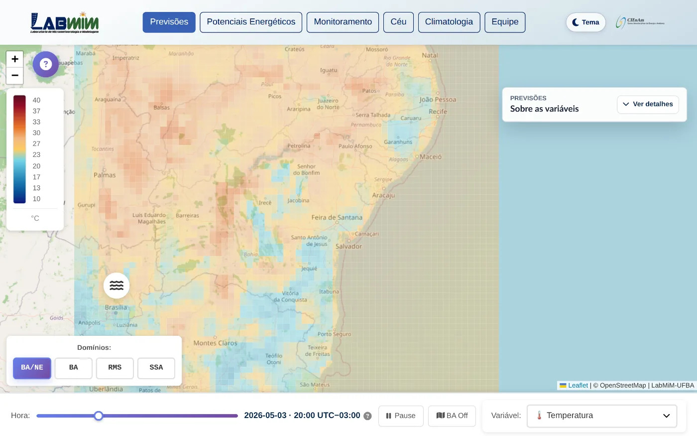
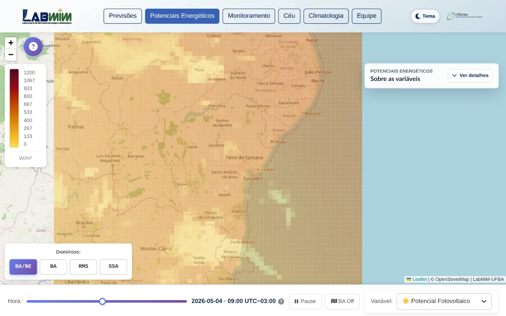
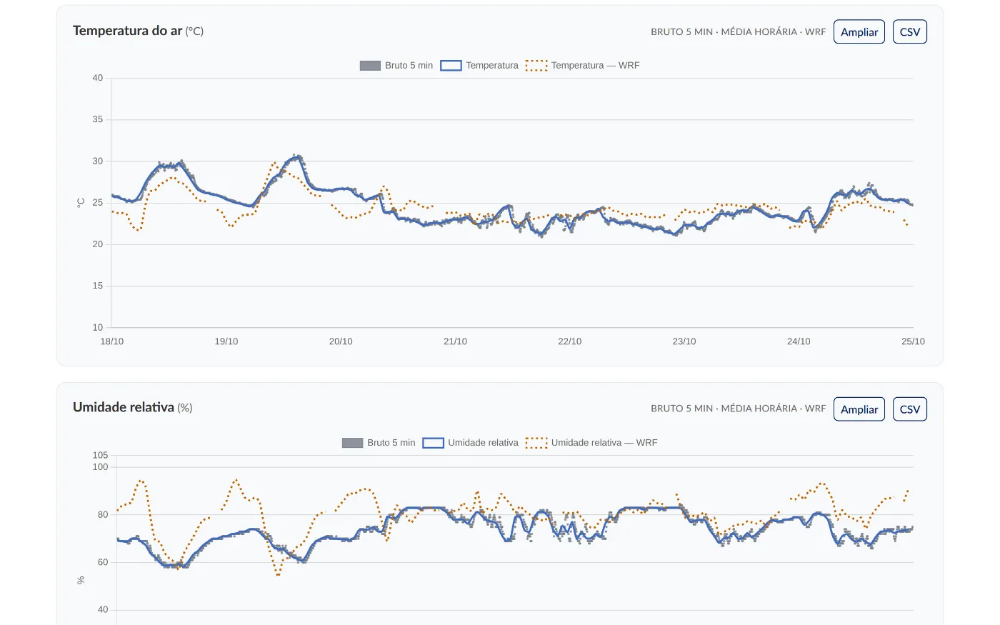
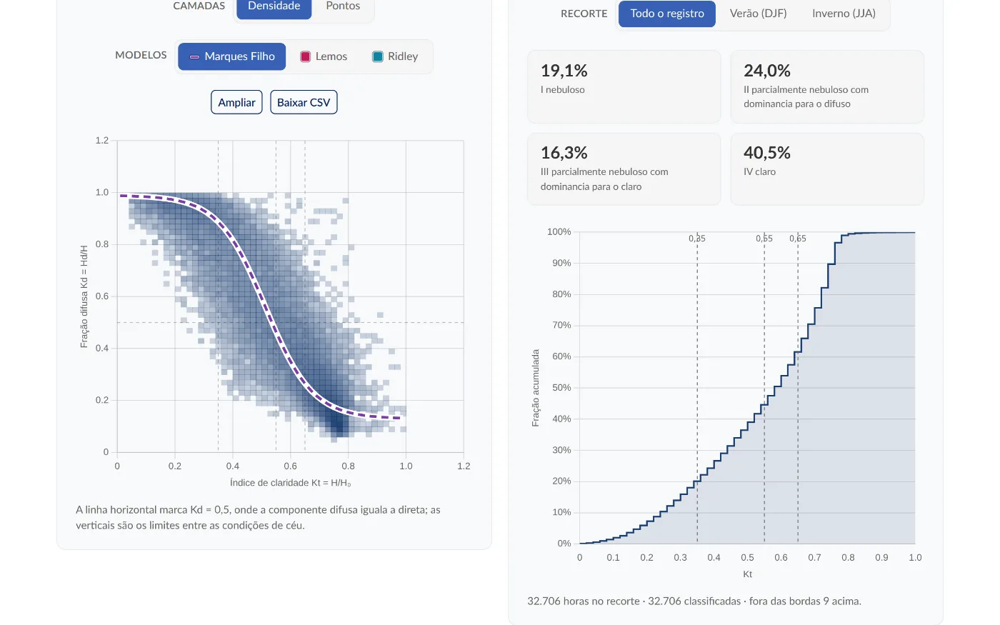
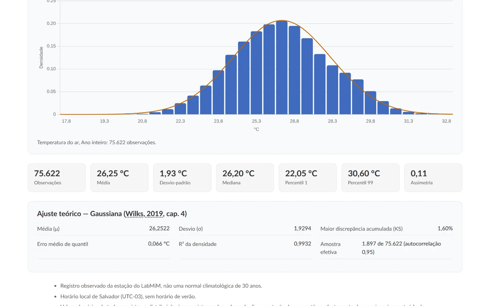
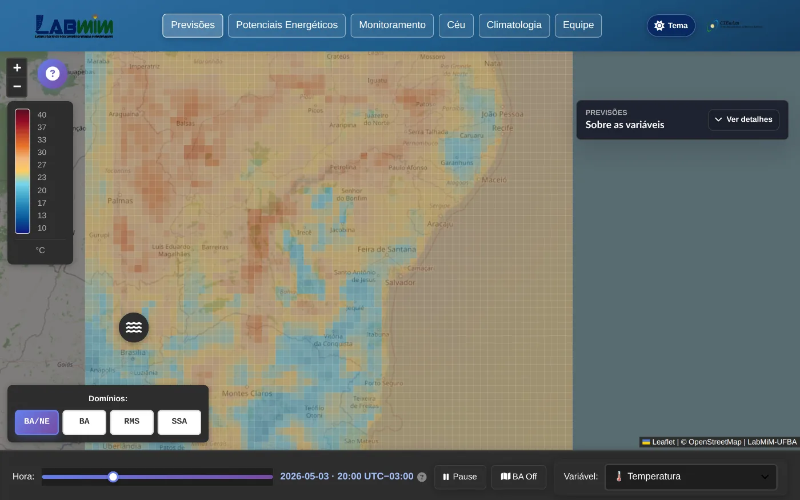

# Sites LabMiM / LEAL

[](https://github.com/Bruno-Mascarenhas/site-labmim/actions/workflows/ci.yml)
[](LICENSE)
[](https://labmim.if.ufba.br/)

Gerador de sites estáticos para publicações meteorológicas de laboratórios universitários — hoje **LabMiM/UFBA**, no ar em <https://labmim.if.ufba.br/>, e **LEAL/UFES** —, preparado para incorporar outros estados e instituições sem duplicar a aplicação. Cada publicação reúne páginas institucionais e os WebGIS de previsões meteorológicas e potenciais energéticos derivados do modelo WRF; monitoramento ambiental, condição do céu e climatologia entram onde o laboratório tem estação e câmera próprias. A saída é HTML, CSS e JavaScript puros, sem backend, sem Node no servidor e sem CDN no caminho crítico; a arquitetura completa está em [Architecture.md](Architecture.md).

Os dados científicos são produzidos fora deste build. Este repositório contém o frontend e usa apenas fixtures artificiais nos testes automatizados — ver [De onde vêm os dados](#de-onde-vêm-os-dados).



_WebGIS de previsões: campo de temperatura do WRF sobre a Bahia e o Nordeste, com seletor de domínio (BA/NE, BA, RMS, SSA), escala de cores e linha do tempo dirigida pelo manifesto da rodada._

## O que o site publica

As páginas são estáticas e recebem produtos científicos preparados pelo laboratório; o build não inclui o acervo de observações.

**Previsões meteorológicas.** A imagem acima: as variáveis da rodada do WRF — temperatura, vento, radiação, precipitação, pressão e umidade —, em quatro domínios aninhados de 27 km a 1 km, com série temporal ao clicar em qualquer célula.

**Potenciais energéticos.** Os mesmos campos do WRF convertidos em potencial fotovoltaico, potencial eólico e densidade eólica a 10 m.



_WebGIS de potenciais energéticos: potencial fotovoltaico em W/m², sobre a mesma base de mapa e os mesmos domínios das previsões._

**Monitoramento da estação.** A janela de sete dias da estação do laboratório, em três camadas sobrepostas.



_Monitoramento da estação: temperatura do ar e umidade relativa em três camadas — amostras brutas de 5 min, média horária e WRF —, com ampliação e leitura de valores ao passar o cursor; a exportação CSV de observações fica desabilitada._

**Condição do céu.** O quadro vivo da câmera all-sky com o mapa de sensibilidade à oclusão da rede sobreposto, a previsão de difusa e de condição do céu com os contrafactuais sem imagem, a linha do tempo dos últimos dias, o cartão do modelo servido (métricas de teste contra controles e referências) e o plano do índice de claridade Kt contra a fração difusa Kd.



_Condição do céu: densidade horária de Kt × Kd com a curva de Marques Filho et al. (2016) e a sobreposição opcional de Lemos et al. (2017) e do BRL de Ridley et al. (2010); ao lado, a curva acumulada de Kt e as quatro condições de céu de Escobedo et al. (2009) — 32.706 horas classificadas na captura._

**Climatologia da estação.** As distribuições observadas do registro, com a densidade teórica ajustada e a bibliografia vinda do próprio manifesto.



_Climatologia: histograma de temperatura do ar com ajuste gaussiano (75.622 observações na captura) e as estatísticas de aderência publicadas junto dos dados._

**Tema claro e escuro.** Vale para todas as páginas: o tema é escolhido pelo leitor, persistido no navegador e propagado aos gráficos sem recarregar a página.



_O mesmo WebGIS no tema escuro: a preferência fica no navegador e os gráficos se reajustam junto._

Cada publicação traz ainda as páginas institucionais — início e equipe —, com identidade visual e SEO próprios.

Quais dessas páginas existem é decidido publicação a publicação, no `pages.js` de cada uma. A UFBA publica as sete — as cinco de dados acima, mais início e equipe; o LEAL, que não tem estação nem câmera all-sky próprias, publica só as institucionais e os dois WebGIS.

## Como rodar localmente

Não abra as páginas por `file://`. Os mapas e os workers dependem de `fetch`, então é preciso servir por HTTP local.

```bash
nvm use      # Node 24, fixado em .nvmrc
npm ci
```

Liste as publicações descobertas e gere a desejada antes de servir:

```bash
npm run sites:list             # lista os src/sites/<id>/site.js e marca o padrão
npm run build                  # publicação padrão em site/
npm run build -- --site=ufba   # publicação específica em site/
npm run build -- --site=ufes
```

Edite sempre `src/`: as páginas de `site/` e todo o `dist/` são saída gerada, e o próximo build sobrescreve qualquer edição feita à mão neles. Nem todo o `site/assets/` é gerado — parte dele é fonte e se edita normalmente; a fronteira exata está em [O que não se edita à mão](CONTRIBUTING.md#o-que-não-se-edita-à-mão).

```bash
make serve                     # serve site/ em http://localhost:8000
```

Sem `make`, use `python3 -m http.server 8000 --bind 127.0.0.1 --directory site`. Se a porta estiver ocupada, escolha outra e mantenha o bind em loopback. Confira:

- <http://localhost:8000/>
- <http://localhost:8000/mapas_interativos.html>
- <http://localhost:8000/potenciais_energeticos.html>
- <http://localhost:8000/ceu.html>

A publicação seleciona o **frontend**; o build não converte nem fornece observações. Para desenvolver, use dados artificiais ou dados próprios com autorização.

Antes de abrir um pull request, `make ci` roda os checks de publicação: build de todas as publicações, verificação de formatação, linters e auditoria de dependências.

Os testes de interface são exclusivamente locais: `npm test` usa o Chromium do Playwright. O CI não instala nem abre navegador. `npm run test:server` verifica as regras de acesso em um Apache temporário via Docker, com dados artificiais e porta restrita a localhost; esse check também roda no CI. Não há type check configurado no projeto.

A lista completa dos scripts npm e dos atalhos do `Makefile` está em [CONTRIBUTING.md](CONTRIBUTING.md#comandos).

## De onde vêm os dados

As previsões vêm do modelo WRF; as observações, dos instrumentos do laboratório.
O processamento científico pertence ao projeto `micrometeorology` e não faz parte
do gerador estático. O acervo, as credenciais e a configuração da infraestrutura
não são distribuídos com este repositório nem cobertos pela licença do código.

### Visualização e dados de pesquisa

Kt × Kd apresenta uma amostra estável de até **5.000 pontos**, limitada a **25%**
das horas selecionadas, sem datas individuais. Densidade, curvas e métricas
continuam baseadas no registro completo. A climatologia pública apresenta os
recortes oferecidos pelo seletor; os CSVs de observações permanecem desabilitados.
O Monitoramento mantém as séries de 5 minutos, o hover e a ampliação necessários
ao diagnóstico dos sensores. Os WebGIS WRF conservam suas exportações.

As figuras completas para artigos são geradas localmente pelos pesquisadores a
partir de seu acervo autorizado. Procedimentos de aquisição, acesso à
infraestrutura, publicação e recuperação permanecem em documentação interna,
fora dos repositórios. Não use dados de produção como fixtures de contribuição.

## Onde está o resto

Este README é o ponto de partida; o detalhe vive nos documentos abaixo.

| Documento                                                        | O que responde                                                                                            |
| ---------------------------------------------------------------- | --------------------------------------------------------------------------------------------------------- |
| [`Architecture.md`](Architecture.md)                             | Organização de pastas, composição das publicações, runtime do WebGIS e checklist de validação.            |
| [`CONTRIBUTING.md`](CONTRIBUTING.md)                             | O fluxo de issue, branch e pull request, os comandos npm e do `Makefile`, e o que não se edita à mão.     |
| [`src/sites/README.md`](src/sites/README.md)                     | Como criar uma publicação, uma página, um território ou um dataset — e as fronteiras entre esses módulos. |
| [`docs/onboarding-architecture/`](docs/onboarding-architecture/) | Os dois PDFs de onboarding — a plataforma e o guia de contribuição —, sua fonte e como regenerá-los.      |
| [`scripts/subset-fontawesome.md`](scripts/subset-fontawesome.md) | Como regenerar o subset da fonte do Font Awesome quando entra um ícone novo.                              |

A publicação é responsabilidade dos mantenedores. Requisitos e procedimentos específicos da infraestrutura ficam na documentação interna.

## Licença

O código deste repositório está sob a [Licença MIT](LICENSE): qualquer pessoa pode usar, copiar, modificar e redistribuir — inclusive em fork ou em uso comercial — sem pagar nada, desde que **mantenha o aviso de copyright e a licença** e cite este repositório como origem.

A permissão cobre o gerador estático e o template. Ela **não** transfere direitos sobre marcas e identidade institucional (logos e nomes de LabMiM/UFBA, LEAL/UFES e parceiros, em `src/sites/<id>/assets/`) nem sobre os dados científicos das instituições, que pertencem às instituições correspondentes — os do WebGIS vêm do pipeline [micrometeorology](https://github.com/Bruno-Mascarenhas/micrometeorology), os demais do acervo de sensores e da câmera all-sky do laboratório. Um fork deve substituir ambos pela própria identidade e pelos próprios dados. As bibliotecas vendorizadas em `site/assets/vendor/` mantêm suas licenças originais (Bootstrap, Leaflet, Chart.js e Font Awesome).
